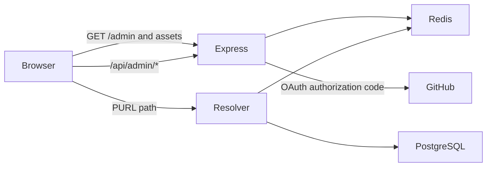

# PURL Resolver Architecture

This document describes the implementation in this repository. For setup and run commands, see [README.md](README.md).

## Design goals

A Persistent URL (PURL) is a stable public path that points indirectly to a resource. The resolver looks up the current destination and returns an HTTP 302 redirect. Operators can repair a destination without changing the published path.

PURL paths are immutable through the admin API. If a semantic path becomes outdated, create a new PURL rather than renaming the existing one. A mapping can be deactivated without deleting its historical identity.

## Runtime topology

The normal production build is a single Node.js process serving both the React dashboard and dynamic requests on one origin:

The implementation can also serve the built React files from static hosting, with API and PURL paths routed to the backend. Hosting-specific configuration is covered in [README.md](README.md), not here.

## Request resolution

The public resolver is mounted after the admin API and static-file middleware in [`src/server.ts`](src/server.ts). A request to `/research/2026/report.pdf` follows this flow:

1. The resolver reads the current cache generation from Redis and checks the fully resolved target cache key for the request path.
2. On a cache miss, it queries PostgreSQL for candidate prefixes: the full request path, each shorter path prefix, and `/`.
3. [`src/resolution.ts`](src/resolution.ts) filters inactive mappings and selects the longest mapping whose path matches exactly or ends at a segment boundary. For example, `/research/data` matches `/research/data/file.pdf`, but not `/research/database`.
4. The resolver appends the remaining request path to the destination's path, retains the destination query and fragment, caches the result for one hour, and returns HTTP 302.
5. If no active mapping matches, the response is `404 PURL not found`. Unexpected lookup or cache failures return HTTP 500.

An exact PURL match redirects to its destination without appending a suffix. `/` can be registered as a root mapping; otherwise a request to `/` is an ordinary resolver request and returns not found. The resolver only accepts HTTP and HTTPS target URLs.

[`src/resolver-app.ts`](src/resolver-app.ts) owns the HTTP behavior and receives database and Redis dependencies. [`src/server.ts`](src/server.ts) supplies the Drizzle query that finds active rows among the candidate paths.

## Database schema

[`src/schema.ts`](src/schema.ts) defines the `purl_mappings` PostgreSQL table with:

- `id`: generated primary key.
- `path`: unique, required PURL path.
- `target_url`: required current destination.
- `title`: required internal label.
- `description`: optional internal note.
- `is_active`: required flag, defaulting to true.
- `created_at` and `updated_at`: timestamps.

Drizzle Kit applies this schema through `npm run db:push`. Compose currently runs that command before starting the app.

## Resolver cache

Redis serves two separate purposes:

- **Resolution cache:** A resolved target is stored for 3600 seconds. The cache key includes a global generation value: `purl:<generation>:<request-path>`.
- **Session store:** `connect-redis` stores Express sessions used by the admin interface.

When an admin creates or updates a mapping, the API increments `purl:cache-version`. Requests then use the new generation, so previously cached nested resolutions become unreachable without scanning Redis for every affected path. Existing keys expire naturally.

## Admin API and path governance

[`src/admin-router.ts`](src/admin-router.ts) exposes these session-protected endpoints under `/api/admin`:

- `GET /purls`: list mappings, newest first.
- `POST /purls`: create a mapping.
- `PUT /purls/:id`: partially update target, title, description, or active status.

There is no delete endpoint. The update handler rejects any payload containing a `path` property. Input validation requires a leading slash, limits path length, accepts ASCII URL-safe path segments, rejects `.` and `..` segments, requires an HTTP(S) destination without embedded credentials, and bounds title and description lengths. Duplicate paths return HTTP 409.

These checks are enforced at the API boundary; direct database writes can bypass them. Operational tooling should preserve the same rules.

## GitHub OAuth and sessions

[`src/auth-router.ts`](src/auth-router.ts) implements the browser authorization-code flow for a GitHub OAuth App, not a GitHub App. It requests the `read:user` scope and:

1. Creates a cryptographically random OAuth `state`, saves it in the session, and redirects to GitHub.
2. Verifies and consumes the returned state before exchanging the code for a token.
3. Fetches the GitHub profile and compares its login, case-insensitively, with `GITHUB_USERNAME`.
4. Rejects other accounts, rotates the session ID on successful authentication, stores the allowed username, and redirects to `/admin`.

The access token is used to read the profile and is not stored. The browser receives an HTTP-only, same-site-lax session cookie named `purl.sid`; it is marked secure when the request is HTTPS and expires after eight hours. Set `TRUST_PROXY=true` only behind a trusted proxy that forwards the original protocol.

`POST /api/admin/auth/logout` destroys the server-side session and clears the cookie. The React dashboard then displays a signed-out view with an explicit sign-in link. It does not immediately restart OAuth, which would silently sign users back in if their GitHub browser session is still active. On an unauthenticated initial dashboard load, a 401 response starts GitHub sign-in.

GitHub's OAuth App **Homepage URL** should be the dashboard URL (`APP_ORIGIN` plus `/admin`). The **Authorization callback URL** is `${APP_ORIGIN}/api/admin/auth/github/callback`. `APP_ORIGIN` itself is only the scheme and host, with no path. See [README.md](README.md) for local and production examples.

## React dashboard and ports

The React 19 dashboard lives in [`web/PurlManager.tsx`](web/PurlManager.tsx). It supports listing, searching, creating, and editing PURLs; toggling active status; and signing out. Paths are displayed as read-only values. The interface has loading, empty, error, and signed-out states.

Vite uses `web/` as its root and builds the static bundle into `dist/public`. In development, Vite binds to port `6677` with `strictPort` and proxies `/api` to `http://127.0.0.1:3000`. The built server does not run Vite: Express serves `/admin` and `dist/public` assets, then routes remaining paths through the PURL resolver.

For Compose, the app listens on container port `PORT` (default `3000`) and publishes it as host port `HOST_PORT` (default `6677`). This is independent of Vite's development-server setting. Do not run Vite and the Compose app simultaneously on host port 6677.

## Startup and configuration

[`src/server.ts`](src/server.ts) validates configuration before opening a listener. Required values are `DATABASE_URL`, `REDIS_URL`, `GITHUB_CLIENT_ID`, `GITHUB_CLIENT_SECRET`, `GITHUB_USERNAME`, and `SESSION_SECRET`. The session secret must contain at least 32 bytes. `PORT` must be an integer from 1 to 65535. `APP_ORIGIN` must be an HTTP(S) origin without a path, query, or fragment; it defaults to `http://localhost:<PORT>`. `TRUST_PROXY=true` trusts one proxy hop.

Startup connects to PostgreSQL and Redis before listening. If startup fails, the process logs the failure, closes any opened clients, and exits unsuccessfully.

## Container and local services

The multi-stage [`Dockerfile`](Dockerfile) compiles the TypeScript server and Vite dashboard, then runs the compiled server on Node.js 24. [`docker-compose.yml`](docker-compose.yml) runs the app with PostgreSQL 16 and Redis 7, waits for database/cache health checks, and preserves database data in the `postgres_data` named volume.

Compose currently runs `npm run db:push` in the container command before `npm start`. That is convenient for the single-app local setup. In multi-instance production deployments, run schema changes once as a controlled migration step rather than from every app instance.

## Tests and build

`npm test` type-checks the tests and runs eight behavior tests across resolver matching, HTTP redirects and caching, admin authorization and validation, and OAuth state/account checks. `npm run build` compiles the server, type-checks the frontend, and bundles the React dashboard.

## Known production limitations

- The server uses a single `pg.Client` rather than a connection pool. A scaled service should use a bounded pool and size it against the database's connection limit.
- The server does not yet handle `SIGTERM`, stop accepting new requests, drain in-flight requests, or close PostgreSQL and Redis clients during shutdown. Add graceful shutdown before deploying to a runtime that replaces instances during scaling or rollout.
- The resolver does not negative-cache misses; unknown paths query PostgreSQL on each request.
- The cache generation is global. Any mapping create/update invalidates all cached resolutions logically, rather than only entries beneath the changed path.
